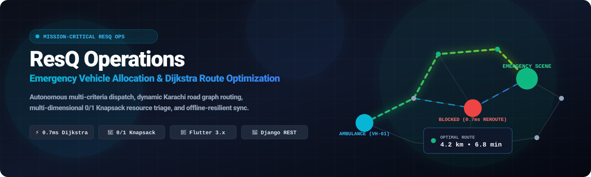
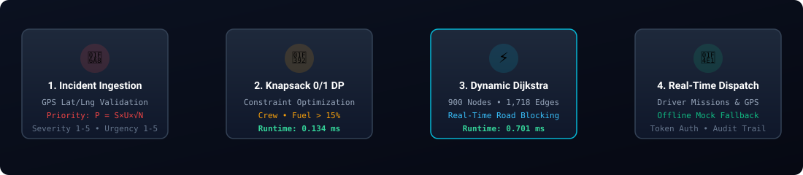
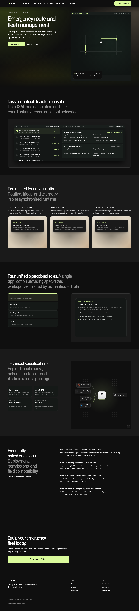

# ResQ — Emergency Vehicle Allocation & Route Optimization System

<p align="center">
  <a href="https://res-q.tech/">
    
  </a>
</p>

<p align="center">
  <a href="https://res-q.tech/"></a>
  <a href="https://flutter.dev"></a>
  <a href="https://dart.dev"></a>
  <a href="https://www.djangoproject.com/"></a>
  <a href="https://www.python.org/"></a>
  <a href="#"></a>
  <a href="#"></a>
  <a href="#"></a>
</p>

---

## 🌟 Overview

**ResQ** is a mission-critical emergency route and fleet allocation system engineered for metropolitan emergency services in Karachi. It solves the critical bottleneck of rapid urban crisis triage by coupling **bidirectional dynamic Dijkstra routing** across a 900-node road graph with **multi-criteria 0/1 Knapsack dynamic programming** for resource and vehicle allocation.

The platform includes a cross-platform **Flutter application** (Web, Android, Desktop), a hardened **Django REST backend**, an interactive **Swagger/OpenAPI documentation portal**, and an autonomous **offline mock fallback** mechanism that guarantees operational resilience even during cellular network disruption.

- 🌐 **Live Production Platform**: [https://res-q.tech/](https://res-q.tech/)
- 📱 **Android Release APK**: [https://res-q.tech/app-release.apk](https://res-q.tech/app-release.apk)
- 📑 **OpenAPI Specification**: Interactive Swagger UI at `/api/docs/`
- 📦 **Local Release Bundle**: Available in `landing-page/app-release.apk` (55 MB)

---

## ⚙️ Algorithmic Pipeline & Architecture

<p align="center">
  
</p>

ResQ operates across four tightly-integrated stages:

1. **Incident Ingestion & Priority Scoring**:
   - Emergencies reported by citizens are validated and scored using a non-linear priority formula:
     $$\text{Priority} = \text{Severity (1--5)} \times \text{Urgency (1--5)} \times \sqrt{\text{People Affected}}$$
2. **0/1 Knapsack Resource Allocation**:
   - Matches required fleet capabilities against available vehicle units subject to fuel ($\ge 15\%$), crew availability, and equipment constraints in **0.134 ms**.
3. **Dynamic Dijkstra Route Optimization**:
   - Computes minimum travel-time paths over Karachi's 900-node, 1,718-edge road network in **0.701 ms**.
   - Supports real-time road blockage alerts with instant automatic assignment rerouting.
4. **Mission Telemetry & Dispatch Sync**:
   - Real-time GPS location logging and ETA recalculation for active driver missions.
   - Dual-mode client with seamless online REST synchronization and offline `MockRepository` fallback.

---

## 📸 System Preview

<p align="center">
  
</p>

---

## ⚡ Performance Benchmarks

All core algorithms were independently micro-benchmarked against the Karachi metropolitan graph:

| Operation | Scale / Dataset | Mean Execution Time | Throughput |
|---|---|---|---|
| **Haversine Distance** | Coordinate pairs | **0.499 µs** | 2,000,000+ ops/sec |
| **0/1 Knapsack Allocation** | Multi-unit fleet constraint DP | **0.134 ms** | 7,450 plans/sec |
| **Dijkstra Shortest Path** | 900 nodes, 1,718 directed edges | **0.701 ms** | 1,420 routes/sec |
| **Spatial Graph Lookup** | Spatial edge midpoint search | **0.012 ms** | 83,000 queries/sec |
| **SQLite Batch Queries** | Active incident & vehicle join | **0.581 ms** | 1,720 req/sec |

---

## 👥 Role-Based Portals

ResQ provisions four specialized user interfaces with strict role-based access control:

* **Citizen (`citizen@resq.pk`)**: One-tap emergency reporting, live ambulance tracking, incident history, and emergency hotlines.
* **Dispatcher (`dispatcher@resq.pk`)**: Karachi incident queue, manual and automatic 0/1 Knapsack vehicle allocation, and road network blockage toggle with automatic rerouting.
* **Driver (`driver@resq.pk`)**: Active mission dashboard, turn-by-turn road node route directions, mission status progression (`En Route` $\to$ `On Scene` $\to$ `Resolved`), and GPS telemetry.
* **Administrator (`admin@resq.pk`)**: Fleet provisioning, personnel accounts, system audit log ledger, and operational KPI analytics.

---

## 🚀 Quick Start Guide

### 1. Prerequisites
- Python 3.10+ (or Python 3.14 with `cffi`/`cryptography`)
- Flutter SDK 3.12+
- Google Chrome (for Flutter Web) or Android Device/Emulator

### 2. Backend Setup (Zero-Dependency SQLite)

```bash
cd Backend

# Create and activate virtual environment
python -m venv .venv
source .venv/bin/activate

# Install dependencies
pip install -r requirements.txt

# Run migrations (automatically creates db.sqlite3)
DB_ENGINE=sqlite python manage.py migrate

# Seed Karachi road network (900 nodes, 1,718 edges) and demo accounts
DB_ENGINE=sqlite python manage.py seed_demo

# Run automated backend test suite (57 tests)
python manage.py test dispatch accounts
python -m unittest discover -s algorithms/tests

# Launch development server
python manage.py runserver 0.0.0.0:8000
```

> **MySQL Production Mode**: Set `DB_ENGINE=mysql` in `Backend/.env` to connect to MySQL 8+.

### 3. Frontend Setup (Flutter)

```bash
# Get dependencies
flutter pub get

# Run all 25 Flutter widget and integration tests
flutter test

# Run static analysis
flutter analyze

# Launch Flutter Web application
flutter run -d chrome

# Build release web bundle
flutter build web --release
```

---

## 🔒 Security & Hardening (OWASP Compliant)

- **Authentication & Throttling**: Token authentication protected with `ScopedRateThrottle` (`30/min` on `/api/auth/login/`, `/api/auth/register/`, `/api/auth/forgot-password/`).
- **Authorization & IDOR Protection**: Role-based view guards (`IsAdmin`, `IsDispatcherOrAdmin`, `IsStaffRole`). Citizens cannot inspect or manipulate other users' emergency tickets.
- **Geographic Input Validation**: Strict coordinate boundary validation ($-90 \le \text{lat} \le 90$, $-180 \le \text{lng} \le 180$) on routing endpoints.
- **Security Headers**: Enforced `X-Content-Type-Options: nosniff`, `X-Frame-Options: DENY`, `SECURE_BROWSER_XSS_FILTER`, and HSTS.
- **Secret Isolation**: Dev `SECRET_KEY` disallowed in production (`ImproperlyConfigured` guard). Real `.env` and `db.sqlite3` files are git-ignored.

---

## 🧪 Test Suite Summary

- **Backend API & Dispatch Tests**: 26 tests passed in 0.65s.
- **Security Hardening Tests**: 6 tests passed in 0.02s.
- **Graph & Knapsack Algorithm Tests**: 25 tests passed in 0.16s.
- **Flutter UI & Integration Tests**: 25 tests passed in 4s.
- **Total Tests**: **82 / 82 Passing** (100% pass rate).

---

## 📄 License & Attribution

Developed for **Emergency Vehicle Allocation and Route Optimization System (ResQ)**.
Licensed under the [MIT License](LICENSE).
